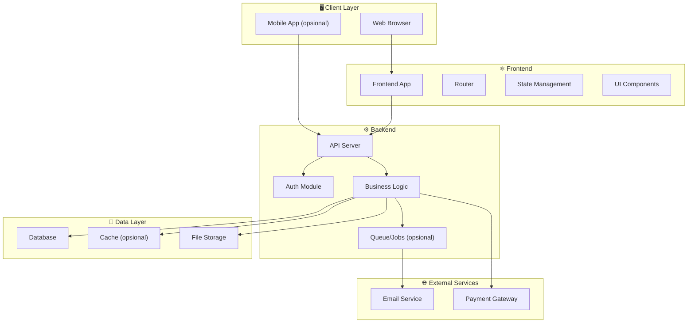
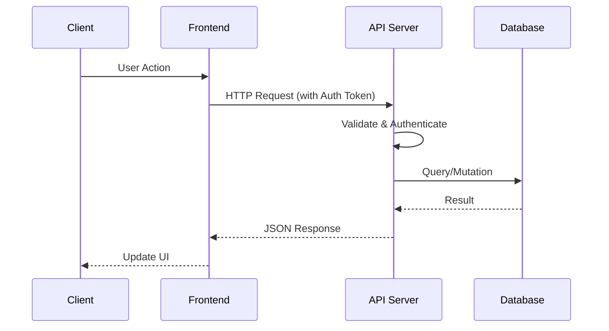
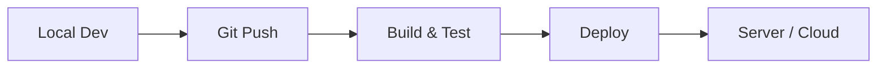

# 🏗️ ARCHITECTURE.md — System Architecture

> **Purpose:** Dokumen ini mendefinisikan arsitektur sistem secara menyeluruh. AI agent membaca file ini untuk memahami bagaimana komponen-komponen saling terhubung.

---

## 1. Architecture Overview

- **Architecture Pattern:** [TODO: contoh: Monolithic / Microservices / Modular Monolith]
- **Communication Pattern:** [TODO: contoh: REST API / GraphQL / WebSocket]
- **Authentication:** [TODO: contoh: JWT / Laravel Sanctum / Session-based]
- **Deployment:** [TODO: contoh: VPS / Docker / Vercel + Railway]

---

## 2. High-Level System Diagram

[TODO: Sesuaikan diagram di bawah dengan arsitektur proyek Anda. Hapus node yang tidak dipakai.]



---

## 3. Component Breakdown

### 3.1 Frontend

[TODO: Isi teknologi yang dipakai untuk setiap komponen.]

- **App Shell:** [TODO: contoh: React + Vite — layout utama, routing, auth guard]
- **State Management:** [TODO: contoh: Zustand — global state, API cache]
- **UI Library:** [TODO: contoh: Custom components / Shadcn / Vuetify]
- **HTTP Client:** [TODO: contoh: Axios / TanStack Query]

### 3.2 Backend

- **API Server:** [TODO: contoh: Laravel 12 — request handling, routing]
- **Authentication:** [TODO: contoh: Sanctum — token management]
- **Business Logic:** [TODO: contoh: Service classes (lihat PATTERNS/)]
- **Queue System:** [TODO: contoh: Laravel Queue — email, notifikasi]

### 3.3 Data Layer

- **Database:** [TODO: contoh: MySQL 8.0 — persistent storage]
- **Cache:** [TODO: contoh: Redis — session, query cache. Atau "Tidak pakai"]
- **File Storage:** [TODO: contoh: Local disk / S3 / Cloudinary]

---

## 4. Data Flow

[TODO: Sesuaikan sequence diagram dengan flow proyek Anda.]



---

## 5. Folder Structure

[TODO: Sesuaikan dengan struktur folder proyek Anda. Hapus bagian yang tidak relevan.]

### Frontend

```
src/
├── assets/          # Static files (images, fonts)
├── components/      # Reusable UI components
│   ├── ui/          # Base components (Button, Input, Modal)
│   └── layout/      # Layout components (Header, Sidebar)
├── pages/           # Page-level components / Route views
├── hooks/           # Custom hooks
├── services/        # API service functions
├── stores/          # State management
├── utils/           # Helper functions
├── types/           # TypeScript types/interfaces
└── styles/          # Global styles
```

### Backend

```
app/
├── Http/
│   ├── Controllers/    # Request handlers
│   ├── Middleware/      # Auth, CORS, rate limiting
│   └── Requests/       # Form validation
├── Models/             # Database models
├── Services/           # Business logic layer
├── Jobs/               # Queue jobs
├── Mail/               # Email templates
└── Policies/           # Authorization policies
database/
├── migrations/         # Database migrations
├── seeders/            # Data seeders
└── factories/          # Model factories
routes/
├── api.php             # API routes
└── web.php             # Web routes
```

---

## 6. Deployment Architecture

[TODO: Sesuaikan dengan setup deployment Anda.]



- **Development:** [TODO: contoh: `http://localhost:3000` (frontend), `http://localhost:8000` (backend)]
- **Staging:** [TODO: contoh: `https://staging.yourdomain.com` — atau "Tidak ada"]
- **Production:** [TODO: contoh: `https://yourdomain.com`]

---

## 7. Security Architecture

[TODO: Definisikan langkah keamanan yang diterapkan.]

- **Authentication:** [TODO: contoh: JWT dengan refresh token rotation]
- **Authorization:** [TODO: contoh: Role-based access control (RBAC)]
- **Data Validation:** [TODO: contoh: Server-side validation di semua input]
- **CORS:** [TODO: contoh: Whitelist specific origins saja]
- **Rate Limiting:** [TODO: contoh: 60 request/menit per IP]
- **Password:** [TODO: contoh: Bcrypt hashing, minimum 8 karakter]
- **SQL Injection:** [TODO: contoh: Menggunakan ORM / parameterized queries]
- **XSS:** [TODO: contoh: Output encoding, CSP headers]

---

## Related Documents

- [STACK.md](./STACK.md) — Detailed technology stack
- [DATABASE.md](./DATABASE.md) — Database schema & ERD
- [API_CONTRACT.md](./API_CONTRACT.md) — API specifications
- [PROJECT_CONTEXT.md](./PROJECT_CONTEXT.md) — Project scope
