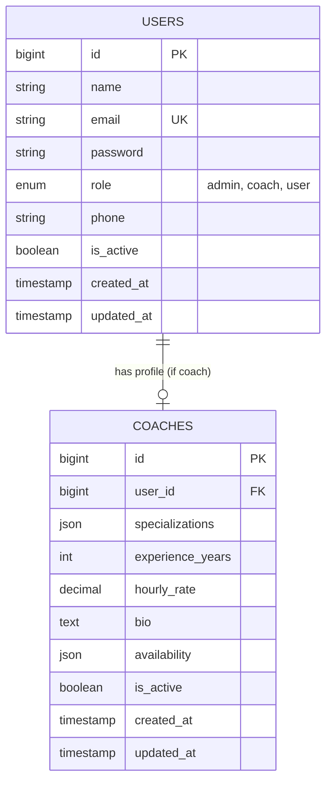

# 💾 DATABASE.md — Database Design & Schema

> **Purpose:** Dokumen ini mendefinisikan desain database Website Gym. AI agent membaca file ini saat membuat model, migration, seeder, atau query.

---

## 1. Database Info

- **Engine:** MySQL 8.0 (Laragon Environment)
- **Charset:** `utf8mb4`
- **Collation:** `utf8mb4_unicode_ci`
- **ORM:** Laravel Eloquent

---

## 2. Naming Conventions

| Jenis | Rule | Contoh |
|---|---|---|
| Tables | snake_case, plural | `users`, `coaches`, `bookings` |
| Columns | snake_case | `first_name`, `created_at` |
| Primary Key | `id` (bigint auto-increment) | `id` |
| Foreign Key | `{singular_table}_id` | `user_id`, `coach_id` |
| Boolean | `is_` / `has_` prefix | `is_active` |
| Timestamps | `created_at`, `updated_at`, `deleted_at` | `created_at` |

---

## 3. Entity-Relationship Diagram (ERD)

---

## 4. Table Schemas

### 4.1 `users`

| Column | Type | Constraints | Description |
|---|---|---|---|
| `id` | BIGINT | PK, AUTO_INCREMENT | Primary key |
| `name` | VARCHAR(255) | NOT NULL | Nama lengkap |
| `email` | VARCHAR(255) | NOT NULL, UNIQUE | Email login |
| `password` | VARCHAR(255) | NOT NULL | Hashed password (bcrypt) |
| `role` | ENUM('admin', 'coach', 'user') | NOT NULL, DEFAULT 'user' | Role otorisasi |
| `phone` | VARCHAR(20) | NULLABLE | Nomor telepon/WA |
| `is_active` | BOOLEAN | DEFAULT true | Status keaktifan akun |
| `created_at` | TIMESTAMP | NULLABLE | Waktu dibuat |
| `updated_at` | TIMESTAMP | NULLABLE | Waktu diubah |

### 4.2 `coaches`

| Column | Type | Constraints | Description |
|---|---|---|---|
| `id` | BIGINT | PK, AUTO_INCREMENT | Primary key |
| `user_id` | BIGINT | FK -> users(id), CASCADE | Relasi ke user |
| `specializations` | JSON | NOT NULL | Array spesialisasi (Bodybuilding, Crossfit, dll) |
| `experience_years` | INT | DEFAULT 0 | Tahun pengalaman pelatih |
| `hourly_rate` | DECIMAL(12,2) | DEFAULT 0.00 | Tarif per jam / sesi (IDR) |
| `bio` | TEXT | NULLABLE | Deskripsi / profil ringkas |
| `availability` | JSON | NULLABLE | Jam operasional / ketersediaan harian |
| `is_active` | BOOLEAN | DEFAULT true | Status ketersediaan pelatih |
| `created_at` | TIMESTAMP | NULLABLE | Waktu dibuat |
| `updated_at` | TIMESTAMP | NULLABLE | Waktu diubah |

---

## 5. Indexes

| Table | Column(s) | Type | Alasan |
|---|---|---|---|
| `users` | `email` | UNIQUE | Fast lookup saat login |
| `users` | `role` | INDEX | Filter user berdasarkan role |
| `coaches` | `user_id` | UNIQUE / FK INDEX | Relasi 1-to-1 ke user |

---

## 6. Migration & Seeder Rules

- Setiap perubahan schema **WAJIB** melalui file migration di Laravel.
- **Seeder default:** `DatabaseSeeder.php` mengisi akun Admin default, Coach default, dan Member test data.

---

## Related Documents

- [ARCHITECTURE.md](./ARCHITECTURE.md) — System architecture
- [API_CONTRACT.md](./API_CONTRACT.md) — API endpoints
- [CODING_RULES.md](./CODING_RULES.md) — Naming conventions

