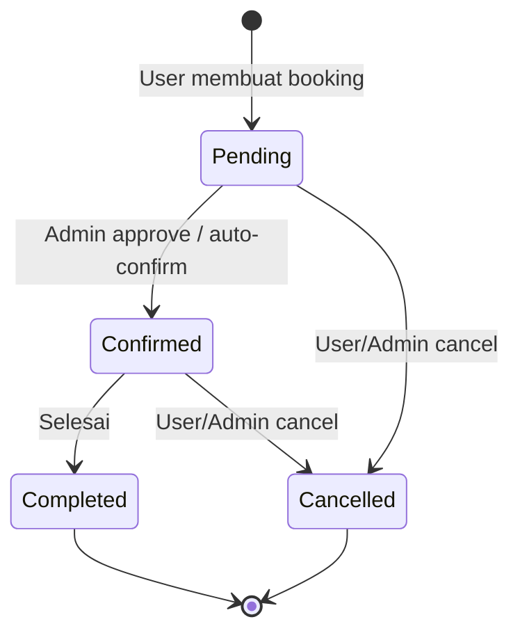

# 📅 BOOKING.md — Booking/Reservation Feature

> **Purpose:** Spesifikasi fitur Booking/Reservation.

---

## 1. Overview

- **Status:** [TODO: pilih: Planned / In Progress / Done]
- **Priority:** [TODO: pilih: High / Medium / Low]
- **Booking Type:** [TODO: contoh: Time-slot based / Date-based / Recurring]

---

## 2. User Stories

- [ ] Sebagai **user**, saya dapat **melihat ketersediaan** jadwal/slot
- [ ] Sebagai **user**, saya dapat **membuat booking** baru
- [ ] Sebagai **user**, saya dapat **melihat daftar booking** saya
- [ ] Sebagai **user**, saya dapat **membatalkan booking**
- [ ] Sebagai **admin**, saya dapat **mengelola semua booking**
- [ ] Sebagai **admin**, saya dapat **mengubah status booking**

---

## 3. Acceptance Criteria

- [ ] User tidak bisa booking slot yang sudah terisi
- [ ] Notifikasi dikirim saat booking berhasil/dibatalkan
- [ ] Admin dapat filter booking berdasarkan status/tanggal
- [ ] Booking memiliki status lifecycle yang jelas

---

## 4. Booking Status Lifecycle

[TODO: Sesuaikan status dengan kebutuhan. Lihat juga GLOSSARY.md.]

---

## 5. API Endpoints

| Method | Endpoint | Auth | Role |
|---|---|---|---|
| `GET` | `/bookings` | ✅ | All |
| `GET` | `/bookings/{id}` | ✅ | All |
| `POST` | `/bookings` | ✅ | User |
| `PUT` | `/bookings/{id}` | ✅ | Admin |
| `DELETE` | `/bookings/{id}` | ✅ | Admin |
| `PATCH` | `/bookings/{id}/status` | ✅ | Admin |

---

## 6. Database Tables

- `bookings` — Data booking utama
- [TODO: tambahkan tabel terkait]

---

## 7. UI Pages

- [ ] Booking Calendar/Schedule View
- [ ] Booking Form
- [ ] Booking List (User)
- [ ] Booking Management (Admin)
- [ ] Booking Detail Modal

---

## Related Documents

- [FLOWS/BOOKING_FLOW.md](../FLOWS/BOOKING_FLOW.md) — Booking flow detail
- [PAYMENT.md](./PAYMENT.md) — Payment integration
- [API_CONTRACT.md](../API_CONTRACT.md) — Full API spec
