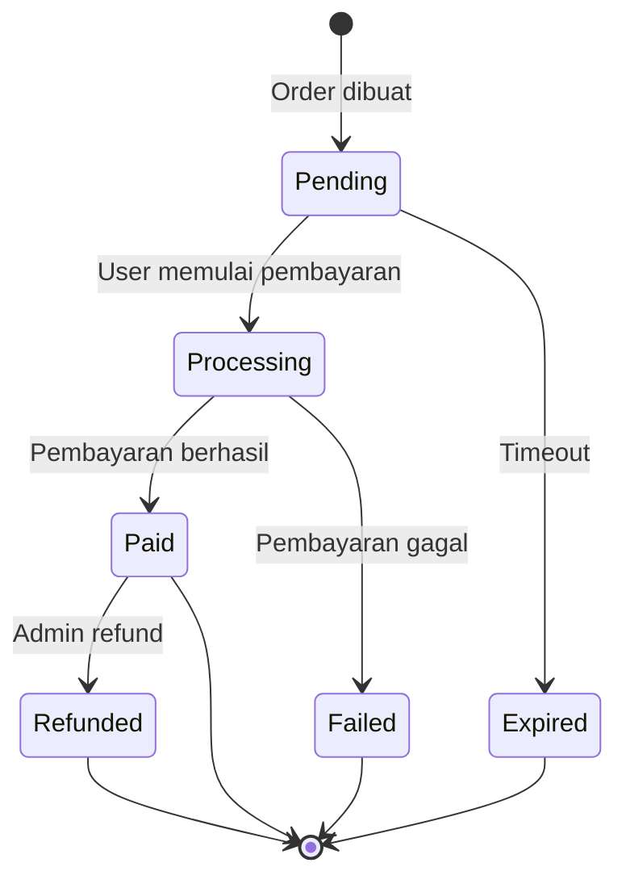

# 💳 PAYMENT.md — Payment Feature

> **Purpose:** Spesifikasi fitur Payment/Transaction.

---

## 1. Overview

- **Status:** [TODO: pilih: Planned / In Progress / Done]
- **Priority:** [TODO: pilih: High / Medium / Low]
- **Payment Gateway:** [TODO: contoh: Midtrans / Stripe / Xendit]
- **Currency:** [TODO: contoh: IDR / USD]

---

## 2. User Stories

- [ ] Sebagai **user**, saya dapat **melakukan pembayaran** untuk booking/order
- [ ] Sebagai **user**, saya dapat **melihat riwayat transaksi**
- [ ] Sebagai **user**, saya dapat **melihat status pembayaran**
- [ ] Sebagai **admin**, saya dapat **melihat semua transaksi**
- [ ] Sebagai **admin**, saya dapat **melakukan refund**

---

## 3. Payment Status Lifecycle

---

## 4. Payment Methods

[TODO: Daftar metode pembayaran yang didukung.]

- **Bank Transfer:** [TODO: contoh: via Midtrans — status: Planned]
- **E-Wallet:** [TODO: contoh: GoPay, OVO — status: Planned]
- **Credit Card:** [TODO: contoh: via Stripe — status: Planned]

---

## 5. API Endpoints

| Method | Endpoint | Auth | Role |
|---|---|---|---|
| `POST` | `/payments` | ✅ | User |
| `GET` | `/payments` | ✅ | All |
| `GET` | `/payments/{id}` | ✅ | All |
| `POST` | `/payments/webhook` | ❌ | — |
| `POST` | `/payments/{id}/refund` | ✅ | Admin |

---

## 6. Database Tables

- `payments` / `transactions` — Data transaksi
- [TODO: tambahkan tabel terkait]

---

## Related Documents

- [BOOKING.md](./BOOKING.md) — Booking feature (payment source)
- [FLOWS/BOOKING_FLOW.md](../FLOWS/BOOKING_FLOW.md) — Full booking+payment flow
