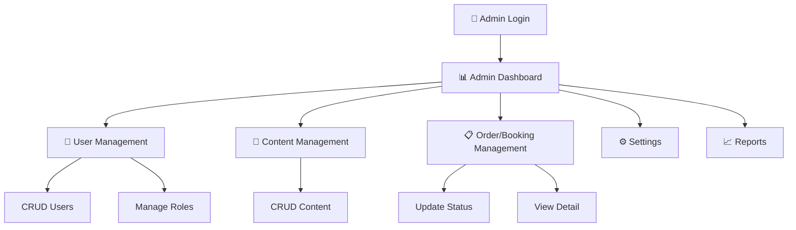

# 🔧 ADMIN_FLOW.md — Admin Workflow

> **Purpose:** Dokumen ini mendefinisikan alur kerja administrator.

---

## 1. Admin Flow Overview

[TODO: Sesuaikan flowchart dengan alur admin proyek Anda.]

---

## 2. Admin Capabilities

### User Management

[TODO: Sesuaikan dengan kebutuhan.]

| Action | Deskripsi | Endpoint |
|---|---|---|
| List Users | Melihat semua user dengan filter & search | `GET /admin/users` |
| Create User | Menambah user baru | `POST /admin/users` |
| Edit User | Mengubah data user | `PUT /admin/users/{id}` |
| Delete User | Menghapus user (soft delete) | `DELETE /admin/users/{id}` |
| Assign Role | Mengubah role user | `PATCH /admin/users/{id}/role` |

### Content Management

[TODO: Sesuaikan dengan kebutuhan.]

| Action | Deskripsi | Endpoint |
|---|---|---|
| [TODO] | [TODO] | [TODO] |

### Order/Booking Management

[TODO: Sesuaikan dengan kebutuhan.]

| Action | Deskripsi | Endpoint |
|---|---|---|
| [TODO] | [TODO] | [TODO] |

---

## 3. Admin Access Control

[TODO: Definisikan level akses. ✅ = Full, 👁️ = View Only, ❌ = No Access]

| Feature | Super Admin | Admin | Staff |
|---|---|---|---|
| User Management | ✅ | 👁️ Edit | ❌ |
| Content Management | ✅ | ✅ | 👁️ |
| Settings | ✅ | ❌ | ❌ |
| Reports | ✅ | 👁️ | ❌ |

---

## Related Documents

- [FEATURES/AUTH.md](../FEATURES/AUTH.md) — Auth & roles
- [FEATURES/DASHBOARD.md](../FEATURES/DASHBOARD.md) — Dashboard spec
- [FLOWS/USER_FLOW.md](./USER_FLOW.md) — End-user flow
