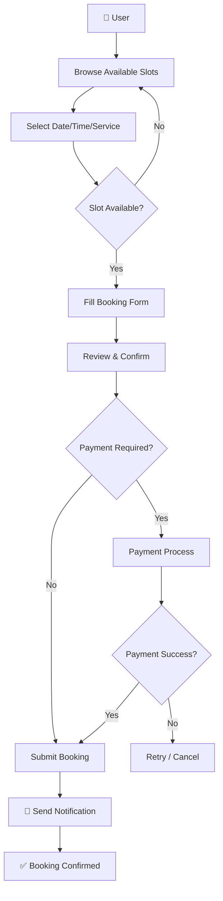
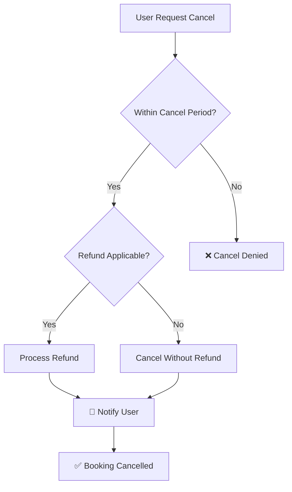

# 📅 BOOKING_FLOW.md — Booking Process Flow

> **Purpose:** Dokumen ini mendefinisikan alur proses booking dari awal hingga selesai.

---

## 1. Booking Flow Diagram

[TODO: Sesuaikan flowchart dengan alur booking proyek Anda.]

---

## 2. Step-by-Step Process

| Step | Actor | Action | System Response | Status |
|---|---|---|---|---|
| 1 | User | Pilih layanan/jadwal | Tampilkan ketersediaan | — |
| 2 | User | Pilih slot tersedia | Validasi ketersediaan | — |
| 3 | User | Isi form booking | Validasi input | — |
| 4 | User | Konfirmasi booking | Buat record booking | `pending` |
| 5 | User | Lakukan pembayaran | Proses payment gateway | `processing` |
| 6 | System | Payment berhasil | Update status | `confirmed` |
| 7 | System | — | Kirim notifikasi | — |
| 8 | System | Hari-H tiba | Auto-update status | `completed` |

---

## 3. Cancellation Flow

[TODO: Sesuaikan dengan kebijakan cancellation proyek Anda.]

---

## 4. Edge Cases

- **Double booking attempt:** Reject, tampilkan error
- **Payment timeout:** Set status `expired`, release slot
- **Admin cancel:** Notify user, process refund
- [TODO: tambahkan edge case lain]

---

## Related Documents

- [FEATURES/BOOKING.md](../FEATURES/BOOKING.md) — Booking feature spec
- [FEATURES/PAYMENT.md](../FEATURES/PAYMENT.md) — Payment feature spec
- [FLOWS/USER_FLOW.md](./USER_FLOW.md) — Overall user flow
