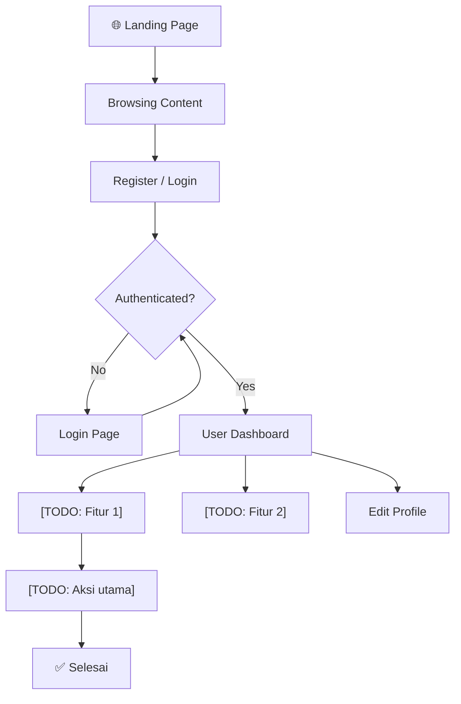

# 👤 USER_FLOW.md — End-User Journey

> **Purpose:** Dokumen ini mendefinisikan alur interaksi end-user dengan sistem.

---

## 1. User Journey Overview

[TODO: Sesuaikan flowchart dengan alur proyek Anda.]

---

## 2. Flow Details

### 2.1 Registration Flow

| Step | User Action | System Response |
|---|---|---|
| 1 | Buka halaman register | Tampilkan form register |
| 2 | Isi data & submit | Validasi input |
| 3 | — | Buat akun, kirim verifikasi email |
| 4 | Klik link verifikasi | Activate akun |
| 5 | — | Redirect ke login/dashboard |

### 2.2 Login Flow

| Step | User Action | System Response |
|---|---|---|
| 1 | Buka halaman login | Tampilkan form login |
| 2 | Isi email & password | Validasi credentials |
| 3 | — | Generate token, redirect ke dashboard |

### 2.3 Main Feature Flow

[TODO: Definisikan flow utama user setelah login.]

| Step | User Action | System Response |
|---|---|---|
| 1 | [TODO] | [TODO] |
| 2 | [TODO] | [TODO] |

---

## 3. Edge Cases & Error Handling

- **Email sudah terdaftar:** Tampilkan error, suggest login
- **Password salah 5x:** Lock akun sementara
- **Token expired:** Redirect ke login
- [TODO: tambahkan edge case lain]

---

## Related Documents

- [FEATURES/AUTH.md](../FEATURES/AUTH.md) — Auth feature spec
- [FLOWS/BOOKING_FLOW.md](./BOOKING_FLOW.md) — Booking flow detail
